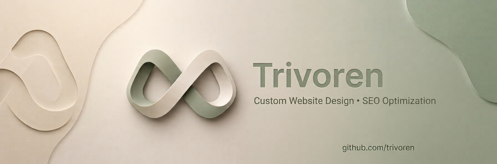

<div align="center">



<br />

# TRIVOREN

### Digital experiences. Engineered to make an impact.

**Freelance Developer · Digital Product Builder · AI-Powered Web Systems**

<br />

[](https://github.com/trivoren)
[](#what-i-build)
[](#technology)

<br />

*Based in Colombia · Working worldwide*

</div>

---

## Beyond websites.

I’m **trivoren** — a freelance developer focused on building digital products that look sharp, work reliably, and solve real business problems.

From conversion-focused websites and e-commerce experiences to custom tools, databases, and AI-powered systems, I turn ideas into useful technology. My approach combines thoughtful design, practical engineering, and a focus on what the product needs to achieve.

**Not just pages. Purpose-built digital products.**

## What I build

<table>
<tr>
<td width="50%" valign="top">

### 🌐 Web experiences
- Business and corporate websites
- Landing pages built around clear calls to action
- Professional portfolios for independent service providers
- Responsive interfaces and custom UI

</td>
<td width="50%" valign="top">

### 🛒 Commerce & business
- E-commerce storefronts
- Product catalogs and detail pages
- WhatsApp-focused lead generation
- QR menus and digital business experiences

</td>
</tr>
<tr>
<td width="50%" valign="top">

### ⚙️ Software & systems
- Web applications and dashboards
- Database-backed tools
- Admin panels and business workflows
- APIs and integrations

</td>
<td width="50%" valign="top">

### 🤖 AI-powered development
- AI-assisted website generation
- Faster digital product workflows
- Automation and intelligent features
- Custom solutions built around the use case

</td>
</tr>
</table>

## Selected work

A few examples of the kinds of experiences I build. Replace the demo URLs below with your live projects.

| Project | What it demonstrates | Preview |
|---|---|---|
| **E-commerce Experience** | Product discovery and online storefront design | [Live demo ↗](https://your-ecommerce-demo.vercel.app) |
| **Professional Portfolio** | Service presentation and direct customer inquiries | [Live demo ↗](https://your-portfolio-demo.vercel.app) |
| **Business Website** | Multi-page structure with WhatsApp-focused conversion paths | [Live demo ↗](https://your-business-demo.vercel.app) |

## How I work

```text
01  UNDERSTAND
    Define the goal, audience, and real business need.
                     ↓
02  DESIGN
    Shape the structure, visual direction, and user journey.
                     ↓
03  BUILD
    Develop the pages, interactions, and required functionality.
                     ↓
04  REFINE
    Review details, responsiveness, and the overall experience.
                     ↓
05  SHIP
    Prepare the project for deployment and real-world use.
```

## Technology

I choose tools based on the project — prioritizing maintainability, performance, and the right fit over unnecessary complexity.

**Core web**


**Backend & data**


**Workflow & deployment**


---

## Building with AI: Numination

**Numination is an AI-powered website generation system I created.** It helps produce complete multi-page website systems in minutes — including e-commerce websites, professional portfolios, and business websites designed to generate inquiries through WhatsApp.

The idea is to move beyond one-off pages and accelerate the creation of connected digital experiences. I use Numination as part of my workflow, then refine each project around its purpose and requirements.

> **I don't build just one page. I build complete systems designed to generate business.**

### Website packages

For clients looking to get online with a clear scope and upfront pricing:

| Package | Ideal for | Price |
|---|---|---:|
| **QR Menu** | Restaurants, cafés, and food businesses | **COP $180,000** |
| **Professional Portfolio** | Barbers, nail artists, DJs, and independent professionals | **COP $250,000** |
| **Multi-page Website** | Businesses that need service pages and WhatsApp inquiries | **COP $400,000** |
| **E-commerce Website** | Businesses showcasing and selling products online | **COP $499,000** |

<sub>Typical delivery: 24–48 hours, depending on scope, content readiness, and project requirements. Final scope and delivery time are confirmed before work begins.</sub>

## A little about me

I work remotely from **Soledad / Barranquilla / Cartagena, Colombia**, collaborating with businesses and people who want to turn an idea into a real digital product.

I value clean execution, direct communication, purposeful design, and technology that earns its place in a project. Whether the solution is a simple portfolio or a larger web system, the goal is the same: make it useful, make it clear, and make it work.

### The principle behind every project

<div align="center">

## “I don't build just one page.
## I build complete systems designed to generate business.”

**— trivoren**

</div>

## Let's connect

Have a project, a business idea, or a collaboration in mind?

- **GitHub:** [github.com/trivoren](https://github.com/trivoren)
- **Location:** Colombia · Available for remote projects worldwide

---

<div align="center">


**TRIVOREN**  
*Web development · Digital products · Software · AI*

</div>
